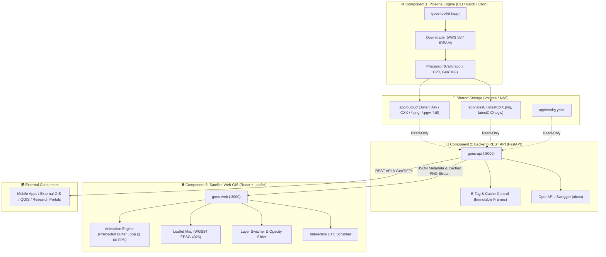

# GOES Imagery Toolkit 🌍

[](https://www.python.org/)
[](LICENSE)
[](https://registry.opendata.aws/noaa-goes/)
[](https://gdal.org/)
[](Dockerfile)
[]()

> **Automated Retrieval, Radiometric Calibration, and Geospatial Mapping for NOAA GOES-16/19 Advanced Baseline Imager (ABI) Level 1b Data.**

---

## 🔬 Overview

The **GOES Imagery Toolkit** is an open-source scientific processing pipeline built to ingest, calibrate, reproject, and visualize Level 1b Radiance (`RadF`) data from NOAA's Geostationary Operational Environmental Satellites (**GOES-16** and **GOES-19** / GOES-East).

Designed for atmospheric research, meteorological forecasting, environmental monitoring, and GIS integration, this toolkit automates the physical conversion of raw satellite radiances into scientifically calibrated products:

* **Brightness Temperature ($T_B$ in °C)** via inverted Planck function and sensor calibration coefficients for infrared and water vapor channels (Bands 07–16).
* **Reflectance ($R$)** normalized by solar irradiance ($E_{sun}$) with gamma correction for visible and near-infrared bands (Bands 01–06).
* **Geostationary-to-Equirectangular Reprojection** (Plate Carrée / WGS84) via high-performance GDAL raster transforms.
* **Cartographic Visualization & GIS Export**: High-resolution PNGs with scientific CPT colormaps, ESRI Worldfiles (`.pgw`), and georeferenced GeoTIFFs compatible with QGIS, ArcGIS, and GeoServer.
* **Tactical & Coordinate Tracking**: Multi-point inspection with customizable nautical-mile concentric range rings (bullseyes) or numbered markers (`P1`, `P2`, ...).

---

## 📐 Scientific & Mathematical Background

### 1. Thermal Infrared Channels: Radiance to Brightness Temperature ($T_B$)
For thermal and water vapor bands (Bands 07 to 16), the sensor measures spectral radiance $L_\lambda$ ($\text{mW} \cdot \text{m}^{-2} \cdot \text{sr}^{-1} \cdot (\text{cm}^{-1})^{-1}$). The effective brightness temperature $T$ (in Kelvin) is derived by inverting the Planck radiation equation using band-specific calibration coefficients:

$$T = \frac{f_{k2}}{\ln\left(\frac{f_{k1}}{L_\lambda} + 1\right)}$$

Applying the spectral response correction with linear band constants $bc_1$ and $bc_2$, the calibrated Celsius brightness temperature is obtained:

$$T_B = \left( \frac{T - bc_1}{bc_2} \right) - 273.15$$

Where $f_{k1}, f_{k2}$ are Planckian constants and $bc_1, bc_2$ are band correction terms specified in the NOAA ABI Level 1b ATBD.

### 2. Visible & Near-Infrared Channels: Radiance to Reflectance ($R$)
For solar reflective bands (Bands 01 to 06), top-of-atmosphere (TOA) reflectance is computed from measured radiance $L_\lambda$, the band solar irradiance constant $E_{sun}$, and normalized Sun-Earth distance $d$:

$$R = \frac{\pi \cdot L_\lambda \cdot d^2}{E_{sun}}$$

To enhance human visual perception of dark surface features while preventing cloud highlight saturation, a non-linear square-root (gamma) transformation is applied:

$$R_{\gamma} = \sqrt{\text{clip}(R, 0, 1)}$$

---

## 🛰️ ABI Band Reference & Scientific Enhancements (RAMMB/CIRA)

The toolkit provides dedicated scientific colormaps (`ch01.cpt` through `ch16.cpt`) inspired by NOAA RAMMB/CIRA standards, tailored for meteorological and environmental phenomena:

| Band | Central $\lambda$ | Spectrum | Native Res. | Colormap | Meteorological Application |
|:---:|:---:|:---:|:---:|:---:|:---|
| **C01** | $0.47\ \mu\text{m}$ | Visible (Blue) | 1 km | `ch01.cpt` | Daytime aerosol, smoke detection, atmospheric haze (Grayscale reflective) |
| **C02** | $0.64\ \mu\text{m}$ | Visible (Red) | 0.5 km | `ch02.cpt` | High-resolution daytime cloud, storm tracking, terrain & land |
| **C03** | $0.86\ \mu\text{m}$ | Near-IR (Veggie) | 1 km | `ch03.cpt` | Chlorophyll/NDVI, burn scars, water body delineation |
| **C04** | $1.37\ \mu\text{m}$ | Near-IR (Cirrus) | 2 km | `ch04.cpt` | Faint high-altitude cirrus cloud detection against dark surface |
| **C05** | $1.61\ \mu\text{m}$ | Near-IR (Snow/Ice) | 1 km | `ch05.cpt` | Snow vs. water-cloud discrimination (ice absorption) |
| **C06** | $2.25\ \mu\text{m}$ | Near-IR (Cloud Size) | 2 km | `ch06.cpt` | Cloud particle effective radius, microphysics |
| **C07** | $3.90\ \mu\text{m}$ | Shortwave IR | 2 km | `ch07.cpt` | Wildfire & hotspot detection, nocturnal fog/stratus |
| **C08** | $6.19\ \mu\text{m}$ | Upper Troposphere WV | 2 km | `ch08.cpt` | Upper-level jet streams, dry slots, dynamical vorticity |
| **C09** | $6.95\ \mu\text{m}$ | Mid Troposphere WV | 2 km | `ch09.cpt` | Mid-tropospheric moisture, synoptic circulation (WV red-black) |
| **C10** | $7.34\ \mu\text{m}$ | Lower Troposphere WV | 2 km | `ch10.cpt` | Low-level humidity, convective storm precursors |
| **C11** | $8.50\ \mu\text{m}$ | Cloud-Top Phase | 2 km | `ch11.cpt` | Cloud thermodynamic phase (ice vs liquid), volcanic $SO_2$ |
| **C12** | $9.61\ \mu\text{m}$ | Ozone | 2 km | `ch12.cpt` | Total column ozone, stratospheric intrusions |
| **C13** | $10.35\ \mu\text{m}$ | Clean Longwave IR | 2 km | `ch13.cpt` | Primary cloud-top temperature, convective storms (Realce Oklahoma / Rainbow) |
| **C14** | $11.20\ \mu\text{m}$ | Traditional Longwave IR| 2 km | `ch14.cpt` | Dvorak hurricane intensity analysis, SST validation |
| **C15** | $12.30\ \mu\text{m}$ | Dirty Longwave IR | 2 km | `ch15.cpt` | Low-level moisture correction, airborne dust & sandstorms |
| **C16** | $13.30\ \mu\text{m}$ | $CO_2$ Longwave IR | 2 km | `ch16.cpt` | Cloud-top height estimation, tropospheric cooling |

### 🎨 Enhancement Families (`default` vs `noaa`)

The toolkit provides a modular enhancement families architecture allowing users to select or customize color palettes across all 16 ABI channels without altering existing files:

* **`default` Family (`--family=default`)**:
  - **Band 13**: Convective Rainbow / Oklahoma enhancement (`colors.rainbow` / `oklahoma.cpt`, $[-90^\circ\text{C}, 50^\circ\text{C}]$).
  - **Band 09**: Mid-tropospheric Water Vapor (`WV_red_black.cpt`, $[-85^\circ\text{C}, -30^\circ\text{C}]$).
  - **Band 01**: Grayscale solar reflectance (`grey255.cpt`, $[0.0, 1.0]$).
  - **Bands 02–16**: Scientific RAMMB/CIRA palettes (`app/colors/default/chXX.cpt`).

* **`noaa` Family (`--family=noaa`)**:
  - Official operational full-disk palettes as published on NOAA/NESDIS/NHC ([goes.noaa.gov](https://goes.noaa.gov/fulldisk.php?sat=G19&src=nhc)).
  - **Bands 01–06**: Linear TOA reflectance grayscale ($[0.0, 1.0]$).
  - **Band 07**: Shortwave IR / Fire temperature anomaly ($[-90^\circ\text{C}, 130^\circ\text{C}]$).
  - **Bands 08–10**: NOAA Water Vapor ($[-90^\circ\text{C}, 20^\circ\text{C}]$).
  - **Bands 11–15**: NOAA Longwave IR window BD/NHC curve ($[-110^\circ\text{C}, 55^\circ\text{C}]$).
  - **Band 16**: Inverted thermal grayscale ($[-120^\circ\text{C}, 50^\circ\text{C}]$).

Configure the global enhancement family in `app/config.yaml`:
```yaml
colors:
  family: "default"   # "default" or "noaa" (can be overridden with --family CLI flag)
```

Custom user families can be added by placing `ch01.cpt` through `ch16.cpt` inside `app/colors/<family_name>/` or using the filename pattern `app/colors/chXX_<family_name>.cpt`.

---

## 🏗️ Architecture & Processing Pipeline



---

## 📦 Installation & Environment Setup

### Option A: Using Conda (Recommended)

1. **Clone the repository**:
   ```bash
   git clone https://github.com/jpantojac/goes-imagery-toolkit.git
   cd goes-imagery-toolkit
   ```

2. **Create and activate the Conda environment**:
   ```bash
   conda env create -f environment.yml
   conda activate goes
   ```

### Option B: Using Docker & Docker Compose

Run the containerized environment with all system dependencies (GDAL, PROJ, GEOS) pre-configured:

1. **Start the Docker stack in the background**:
   ```bash
   docker compose up -d
   ```

2. **Execute commands directly from your host terminal**:
   ```bash
   # Manual mode for specific observation date & time:
   docker compose exec app python main.py --mode="manual" --source="aws" --date=20240929 --hours=11 --minutes=00

   # Automated near-real-time stream:
   docker compose exec app python main.py --mode="auto" --source="aws" --label=true
   ```

3. **Or open an interactive Bash shell inside the container**:
   ```bash
   docker compose exec app bash
   # Inside the /app working directory:
   python main.py --mode="auto" --source="aws" --label=true
   ```

---

## 🚀 Usage Guide

> [!TIP]
> **Running with Docker vs. Conda**:
> - **With Conda (Local Environment)**: Run `python app/main.py [flags...]` from the repository root.
> - **With Docker (Containerized)**: Run `docker compose exec app python main.py [flags...]` directly from your host shell.

The tool supports two execution modes: **Manual** (historical events and targeted coordinates) and **Automated** (near-real-time streaming).

### 1. Manual Mode (Specific Date & Time)

#### Example 1: Full Regional Domain
```bash
python app/main.py --mode="manual" --source="aws" --date=20240929 --hours=11 --minutes=00
```

#### Example 2: Target Coordinate with Nautical Mile Bullseye
Generate imagery centered on a target location (e.g. Bogota, Colombia `lat=4.711`, `lon=-74.072`) with 200 NM concentric distance rings:
```bash
python app/main.py \
  --mode="manual" \
  --source="aws" \
  --date=20240929 \
  --hours=11,12 \
  --minutes=00 \
  --lat=4.711 \
  --lon=-74.072 \
  --label=true \
  --bullseye=true
```

#### Example 3: Multi-Waypoint Analysis (Numbered Markers P1, P2, ...)
Highlight multiple coordinates across a storm path without distance rings:
```bash
python app/main.py \
  --mode="manual" \
  --source="aws" \
  --date=20240929 \
  --hours=11 \
  --minutes=00 \
  --lat=4.711,10.968,6.244 \
  --lon=-74.072,-74.781,-75.581 \
  --bullseye=false \
  --label=true
```

#### Example 4: High-Resolution Clean Imagery Without Borders / Croquis
Generate ultra-sharp satellite images (e.g. at 4096px resolution or native resolution `--max-dim=0`) without vector outlines or administrative borders:
```bash
python app/main.py \
  --mode="manual" \
  --source="aws" \
  --date=20240929 \
  --hours=11 \
  --minutes=00 \
  --croquis=false \
  --max-dim=4096
```

### 2. Automated Mode (Near Real-Time)

Download and generate products for the most recent observation from the NOAA public S3 bucket:
```bash
python app/main.py --mode="auto" --source="aws" --label=true
```

### 3. CLI Argument Reference

| Argument (English) | Alias (Spanish) | Type | Default | Description |
|:---|:---|:---:|:---:|:---|
| `--mode` | `--tipo` | `str` | *Required* | Execution mode: `manual` or `auto`. |
| `--source` | `--fuente` | `str` | *Required* | Ingestion source: `aws` (NOAA S3 bucket) or `ideam`. |
| `--date` | `--fecha`, `--dates` | `str` | `None` | Date in `YYYYMMDD` format (comma-separated for multiple dates). |
| `--hours` | `--horas` | `str` | `None` | UTC hours in `HH` format (comma-separated, e.g. `00,06,12`). |
| `--minutes` | `--minutos` | `str` | `None` | Minutes in `MM` format (comma-separated, e.g. `00,30`). |
| `--lat` | | `str` | `None` | Target latitude(s) between -90 and 90 (comma-separated). |
| `--lon` | | `str` | `None` | Target longitude(s) between -180 and 180 (comma-separated). |
| `--label` | | `bool` | `False` | Render title bar, colorbar, and metadata (`true`/`false`). |
| `--bullseye` | | `bool` | `True` | Draw concentric range rings (`true`) or marker pins (`false`). |
| `--watermark` | `--institution`, `--institucion` | `str` | `config.yaml` | Custom label or institution text rendered on bottom bar. |
| `--overwrite` | `--force` | `bool` | `False` | Force re-generation of products even if `.png` and `.tif` already exist (`true`/`false`). |
| `--family` | `--palette`, `--enhancement` | `str` | `default` | Colormap enhancement family: `default` (Oklahoma on C13, WV on C09) or `noaa` (official goes.noaa.gov full-disk palettes). |
| `--c16-enhanced` | `--c16-color` | `bool` | `False` | Display Band 16 (CO2) with convective BD color enhancement instead of thermal grayscale (`true`/`false`). |
| `--borders` | `--croquis` | `bool` | `True` | Draw administrative vector boundaries (departments and countries / croquis) (`true`/`false`). |
| `--max-dim` | `--resolution-px` | `int` | `2048` | Maximum output raster dimension in pixels (e.g. `2048`, `4096`, or `0` for uncompressed native resolution). |
| `--satellite` | `--sat` | `str` | `auto` | Target GOES satellite (`G16`, `G19`, or `auto`). Defaults to `auto`: automatically selects GOES-16 for observations before April 7, 2025 and GOES-19 for subsequent observations. |

---

## ⚡ Performance & Parallel Processing

The toolkit features a concurrent download engine, an asynchronous producer-consumer pipeline, and dual-layer caching designed for high-throughput operational and research workloads:

- **Multi-threaded S3 Ingestion**: Spectral channels (Bands 01 to 16) are retrieved in parallel via `ThreadPoolExecutor` rather than sequential queries, reducing retrieval time by up to **75%**.
- **Per-Thread Progress Logging**: Ingest progress is logged per thread with percentage bars and channel tags (`[C01]`, `[C13]`), allowing clear monitoring of multi-megabyte transfers.
- **Asynchronous Pipeline Overlap**: As soon as an individual channel NetCDF finishes downloading, spatial remapping (GDAL) and rendering (Matplotlib) begin immediately in the consumer loop while remaining channels continue downloading in background worker threads.
- **Dual-Layer Caching Architecture**:
  1. **Input S3 NetCDF Cache**: Checks for pre-existing raw `.nc` files matching target timestamps on disk (`0 ms` latency), eliminating redundant NOAA S3 queries and saving network bandwidth.
  2. **Output Product Cache**: Checks if target `.png` (and `.tif` if enabled) already exist in `output/<julian_day>/C<band>/`. If already generated and `--overwrite=false`, remapping and plotting are skipped entirely, completing repeated runs in **under 1 second**. Use `--overwrite=true` or `--force=true` to regenerate.

### Concurrency Configuration (`app/config.yaml`)

Tune worker concurrency to your machine's hardware and network capacity:

```yaml
performance:
  max_download_workers: 4       # Concurrent download worker threads (recommended: 4 to 8)
  enable_pipeline_overlap: true  # Concurrently trigger image processing as downloads complete
```

---

## 🌐 Web GIS Interactive Viewer & REST API

The toolkit includes an enterprise-grade, microservices-based web visualization stack and RESTful API that can run independently or alongside the image generation pipeline:

### 1. High-Performance Web GIS (`goes-web`)
* **60 FPS Fluid Temporal Animations**: Utilizes double-buffering preloaded Leaflet overlays, eliminating raster reload flicker and browser memory spikes.
* **Spectral Band Selector**: Intuitive grouped switching across Visible (C01–C02), Near-IR (C03–C06), Water Vapor (C08–C10), and Longwave Thermal IR (C07, C11–C16).
* **Transparency & Opacity Control**: Real-time 0% to 100% opacity slider to blend satellite imagery with underlying terrain or base cartography.
* **Calibrated Meteorological Colorbar**: Dynamically displays the active channel's temperature (°C) or reflectance (%) scale and physical limits.
* **Interactive UTC Timeline Scrubber**: Drag-and-drop timeline, variable playback speed (1 to 20 FPS), frame step buttons, and frame count selector (6, 12, 24, 48).
* **Basemap Switcher**: High-contrast CartoDB Dark Matter, ESRI World Imagery (Satellite), and OpenStreetMap.
* **Direct Product Download**: Instant one-click download of the current visual PNG or 16-bit GeoTIFF for GIS analysis (QGIS/ArcGIS).

### 2. Backend REST API (`goes-api`)
Built on **FastAPI** with automatic interactive OpenAPI / Swagger documentation (`http://localhost:8000/docs`):

| Endpoint | Method | Description |
|:---|:---:|:---|
| `/api/v1/health` | `GET` | Health check, storage mounts, and disk space diagnostics. |
| `/api/v1/metadata/bounds` | `GET` | Geographical bounding box (`EPSG:4326`), Leaflet bounds, and default map center. |
| `/api/v1/channels` | `GET` | Complete metadata registry for all 16 ABI channels (wavelength, resolution, meteorological application). |
| `/api/v1/legends/{channel}` | `GET` | Calibrated colorbar stops, CSS linear gradient, and physical units (°C or %). |
| `/api/v1/catalog` | `GET` | Temporal inventory of processed Julian days, channels, and frame counts. |
| `/api/v1/latest` | `GET` | Quick metadata and URLs for the most recent observation across all channels. |
| `/api/v1/frames` | `GET` | Chronological frame sequences for animation (`channel`, `limit`, `date`). |
| `/api/v1/images/{day}/{ch}/{file}` | `GET` | Stream satellite PNGs/GeoTIFFs with aggressive `ETag` and `Cache-Control` headers. |

### 3. Running the Stack with Docker Compose

Run all three decoupled services or any subset:

```bash
# Start the full stack (Pipeline + Backend API + Web GIS):
docker compose up -d

# Start only the Backend REST API (for external applications / mobile / QGIS):
docker compose up -d api

# Start only the Web GIS and API:
docker compose up -d api web

# Access points:
# Web GIS Interface:  http://localhost:3001
# OpenAPI / Swagger:  http://localhost:8000/docs
# Pipeline Generator: docker compose exec app python main.py [flags...]
```

### 4. Running Locally (Without Docker)

```bash
# Start Backend API:
python -m uvicorn api.main:app --reload --port 8000

# Start Frontend (in a separate terminal):
cd web
npm install
npm run dev
# Opens at http://localhost:5173
```

---

## 📁 Output Products

Files are structured by Julian day and spectral channel:

```
output/
└── <julian_day>/             # e.g., 273 (September 29)
    ├── C01/                  # Band 01 - Visible Blue
    ├── C09/                  # Band 09 - Mid Troposphere Water Vapor
    └── C13/                  # Band 13 - Clean Longwave Infrared
        ├── 202409291100.png  # Calibrated visual PNG with colormap
        ├── 202409291100.pgw  # ESRI Worldfile for georeferencing
        └── 202409291100.tif  # 16-bit GeoTIFF raster for GIS software
latest/
    └── latestC13.png         # Fast preview of the latest processed frame
```

---

## 🧪 Testing & Quality Assurance

Run the test suite:

```bash
# Run concurrency, caching, and pipeline overlap unit tests
python -m unittest tests/test_download_concurrency.py

# Run pure radiometric calibration and coordinate validation unit tests
python -m unittest tests/test_calibration_and_geometry.py

# Run full visual generation tests (requires local NetCDF sample and GDAL)
python -m unittest tests/test_image_generation.py
```

---

## 📖 Citation

If you use this toolkit in academic research, thesis projects, or operational reports, please cite it using:

```bibtex
@software{pantoja2026goes,
  author       = {Julian Pantoja Clavijo},
  title        = {GOES Imagery Toolkit: Automated Processing, Radiometric Calibration, and Cartographic Visualization for GOES-16/19 ABI Data},
  year         = {2026},
  version      = {1.0.0},
  url          = {https://github.com/jpantojac/goes-imagery-toolkit},
  license      = {MIT}
}
```

---

## 📄 License

This project is licensed under the [MIT License](LICENSE) &copy; 2024–2026 Julian Pantoja Clavijo.
