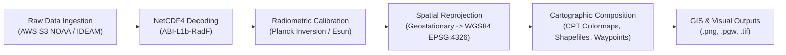

# GOES Imagery Toolkit 🌍

[](https://www.python.org/)
[](LICENSE)
[](https://registry.opendata.aws/noaa-goes/)
[](https://gdal.org/)
[](Dockerfile)
[]()

> **Automated Retrieval, Radiometric Calibration, and Geospatial Mapping for NOAA GOES-16/19 Advanced Baseline Imager (ABI) Level 1b Data.**

---

## 🔬 Overview

The **GOES Imagery Toolkit** is an open-source scientific processing pipeline built to ingest, calibrate, reproject, and visualize Level 1b Radiance (`RadF`) data from NOAA's Geostationary Operational Environmental Satellites (**GOES-16** and **GOES-19** / GOES-East).

Designed for atmospheric research, meteorological forecasting, environmental monitoring, and GIS integration, this toolkit automates the physical conversion of raw satellite radiances into scientifically calibrated products:

* **Brightness Temperature ($T_B$ in °C)** via inverted Planck function and sensor calibration coefficients for infrared and water vapor channels (Bands 07–16).
* **Reflectance ($R$)** normalized by solar irradiance ($E_{sun}$) with gamma correction for visible and near-infrared bands (Bands 01–06).
* **Geostationary-to-Equirectangular Reprojection** (Plate Carrée / WGS84) via high-performance GDAL raster transforms.
* **Cartographic Visualization & GIS Export**: High-resolution PNGs with scientific CPT colormaps, ESRI Worldfiles (`.pgw`), and georeferenced GeoTIFFs compatible with QGIS, ArcGIS, and GeoServer.
* **Tactical & Coordinate Tracking**: Multi-point inspection with customizable nautical-mile concentric range rings (bullseyes) or numbered markers (`P1`, `P2`, ...).

---

## 📐 Scientific & Mathematical Background

### 1. Thermal Infrared Channels: Radiance to Brightness Temperature ($T_B$)
For thermal and water vapor bands (Bands 07 to 16), the sensor measures spectral radiance $L_\lambda$ ($\text{mW} \cdot \text{m}^{-2} \cdot \text{sr}^{-1} \cdot (\text{cm}^{-1})^{-1}$). The effective brightness temperature $T$ (in Kelvin) is derived by inverting the Planck radiation equation using band-specific calibration coefficients:

$$T = \frac{f_{k2}}{\ln\left(\frac{f_{k1}}{L_\lambda} + 1\right)}$$

Applying the spectral response correction with linear band constants $bc_1$ and $bc_2$, the calibrated Celsius brightness temperature is obtained:

$$T_B = \left( \frac{T - bc_1}{bc_2} \right) - 273.15$$

Where $f_{k1}, f_{k2}$ are Planckian constants and $bc_1, bc_2$ are band correction terms specified in the NOAA ABI Level 1b ATBD.

### 2. Visible & Near-Infrared Channels: Radiance to Reflectance ($R$)
For solar reflective bands (Bands 01 to 06), top-of-atmosphere (TOA) reflectance is computed from measured radiance $L_\lambda$, the band solar irradiance constant $E_{sun}$, and normalized Sun-Earth distance $d$:

$$R = \frac{\pi \cdot L_\lambda \cdot d^2}{E_{sun}}$$

To enhance human visual perception of dark surface features while preventing cloud highlight saturation, a non-linear square-root (gamma) transformation is applied:

$$R_{\gamma} = \sqrt{\text{clip}(R, 0, 1)}$$

---

## 🛰️ ABI Band Reference Guide

| Band | Central $\lambda$ | Spectrum | Native Res. | Meteorological Application |
|:---:|:---:|:---:|:---:|:---|
| **C01** | $0.47\ \mu\text{m}$ | Visible (Blue) | 1 km | Daytime aerosol, smoke detection, atmospheric haze |
| **C02** | $0.64\ \mu\text{m}$ | Visible (Red) | 0.5 km | Daytime cloud, storm tracking, terrain & land monitoring |
| **C03** | $0.86\ \mu\text{m}$ | Near-IR (Veggie) | 1 km | Vegetation index (NDVI), burn scars, water body delineation |
| **C07** | $3.90\ \mu\text{m}$ | Shortwave IR | 2 km | Wildfire detection, hot spot analysis, fog/low stratus detection |
| **C08** | $6.19\ \mu\text{m}$ | Upper Troposphere WV | 2 km | High-altitude atmospheric winds, jet stream dynamics |
| **C09** | $6.95\ \mu\text{m}$ | Mid Troposphere WV | 2 km | Mid-tropospheric moisture, synoptic vorticity tracking |
| **C10** | $7.34\ \mu\text{m}$ | Lower Troposphere WV | 2 km | Low-level humidity, precursor to convective storm initiation |
| **C13** | $10.35\ \mu\text{m}$ | Clean Longwave IR | 2 km | Cloud-top temperature, convective storm depth, severe weather |

---

## 🏗️ Architecture & Processing Pipeline



---

## 📦 Installation & Environment Setup

### Option A: Using Conda (Recommended)

1. **Clone the repository**:
   ```bash
   git clone https://github.com/jpantojac/goes-imagery-toolkit.git
   cd goes-imagery-toolkit
   ```

2. **Create and activate the Conda environment**:
   ```bash
   conda env create -f environment.yml
   conda activate goes
   ```

### Option B: Using Docker & Docker Compose

Run the containerized environment with all system dependencies (GDAL, PROJ, GEOS) pre-configured:

```bash
docker compose up -d
docker compose exec app bash
```

---

## 🚀 Usage Guide

The tool supports two execution modes: **Manual** (historical events and targeted coordinates) and **Automated** (near-real-time streaming).

### 1. Manual Mode (Specific Date & Time)

#### Example 1: Full Regional Domain
```bash
python app/main.py --mode="manual" --source="aws" --date=20240929 --hours=11 --minutes=00
```

#### Example 2: Target Coordinate with Nautical Mile Bullseye
Generate imagery centered on a target location (e.g. Bogota, Colombia `lat=4.711`, `lon=-74.072`) with 200 NM concentric distance rings:
```bash
python app/main.py \
  --mode="manual" \
  --source="aws" \
  --date=20240929 \
  --hours=11,12 \
  --minutes=00 \
  --lat=4.711 \
  --lon=-74.072 \
  --label=true \
  --bullseye=true
```

#### Example 3: Multi-Waypoint Analysis (Numbered Markers P1, P2, ...)
Highlight multiple coordinates across a storm path without distance rings:
```bash
python app/main.py \
  --mode="manual" \
  --source="aws" \
  --date=20240929 \
  --hours=11 \
  --minutes=00 \
  --lat=4.711,10.968,6.244 \
  --lon=-74.072,-74.781,-75.581 \
  --bullseye=false \
  --label=true
```

### 2. Automated Mode (Near Real-Time)

Download and generate products for the most recent observation from the NOAA public S3 bucket:
```bash
python app/main.py --mode="auto" --source="aws" --label=true
```

### 3. CLI Argument Reference

| Argument (English) | Alias (Spanish) | Type | Default | Description |
|:---|:---|:---:|:---:|:---|
| `--mode` | `--tipo` | `str` | *Required* | Execution mode: `manual` or `auto`. |
| `--source` | `--fuente` | `str` | *Required* | Ingestion source: `aws` (NOAA S3 bucket) or `ideam`. |
| `--date` | `--fecha`, `--dates` | `str` | `None` | Date in `YYYYMMDD` format (comma-separated for multiple dates). |
| `--hours` | `--horas` | `str` | `None` | UTC hours in `HH` format (comma-separated, e.g. `00,06,12`). |
| `--minutes` | `--minutos` | `str` | `None` | Minutes in `MM` format (comma-separated, e.g. `00,30`). |
| `--lat` | | `str` | `None` | Target latitude(s) between -90 and 90 (comma-separated). |
| `--lon` | | `str` | `None` | Target longitude(s) between -180 and 180 (comma-separated). |
| `--label` | | `bool` | `False` | Render title bar, colorbar, and metadata (`true`/`false`). |
| `--bullseye` | | `bool` | `True` | Draw concentric range rings (`true`) or marker pins (`false`). |
| `--watermark` | `--institution`, `--institucion` | `str` | `config.yaml` | Custom label or institution text rendered on bottom bar. |

---

## 📁 Output Products

Files are structured by Julian day and spectral channel:

```
output/
└── <julian_day>/             # e.g., 273 (September 29)
    ├── C01/                  # Band 01 - Visible Blue
    ├── C09/                  # Band 09 - Mid Troposphere Water Vapor
    └── C13/                  # Band 13 - Clean Longwave Infrared
        ├── 202409291100.png  # Calibrated visual PNG with colormap
        ├── 202409291100.pgw  # ESRI Worldfile for georeferencing
        └── 202409291100.tif  # 16-bit GeoTIFF raster for GIS software
latest/
    └── latestC13.png         # Fast preview of the latest processed frame
```

---

## 🧪 Testing & Quality Assurance

Run the test suite:

```bash
# Run pure radiometric calibration and coordinate validation unit tests
python -m unittest tests/test_calibration_and_geometry.py

# Run full visual generation tests (requires local NetCDF sample and GDAL)
python -m unittest tests/test_image_generation.py
```

---

## 📖 Citation

If you use this toolkit in academic research, thesis projects, or operational reports, please cite it using:

```bibtex
@software{pantoja2026goes,
  author       = {Julian Pantoja Clavijo},
  title        = {GOES Imagery Toolkit: Automated Processing, Radiometric Calibration, and Cartographic Visualization for GOES-16/19 ABI Data},
  year         = {2026},
  version      = {1.0.0},
  url          = {https://github.com/jpantojac/goes-imagery-toolkit},
  license      = {MIT}
}
```

---

## 📄 License

This project is licensed under the [MIT License](LICENSE) &copy; 2024–2026 Julian Pantoja Clavijo.
